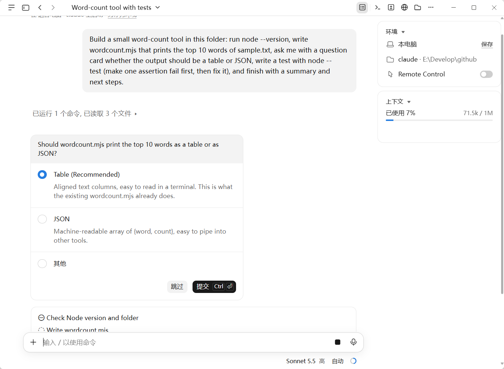
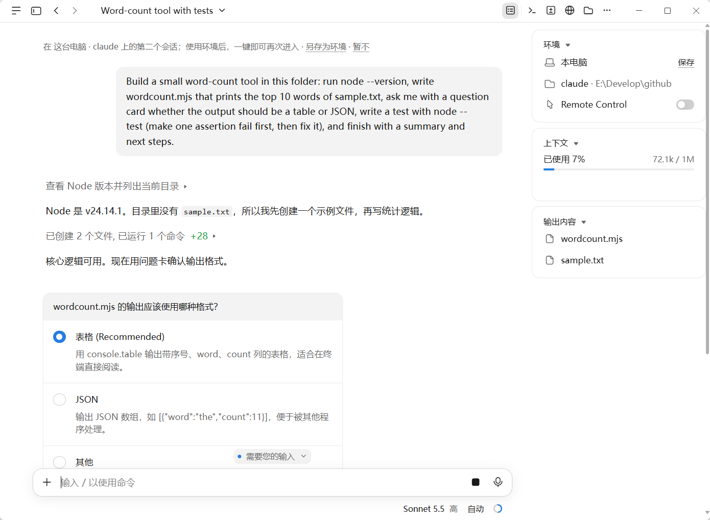
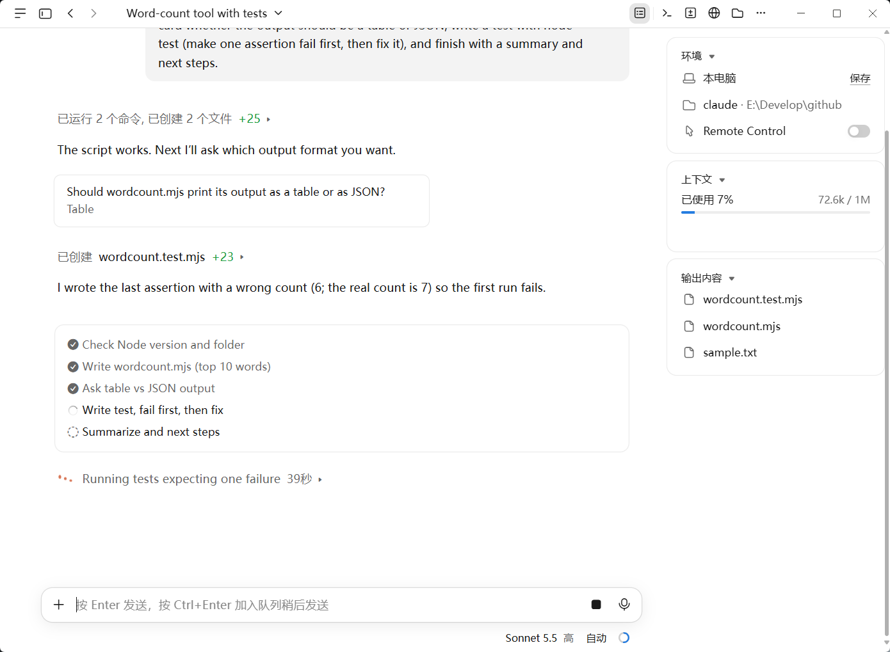
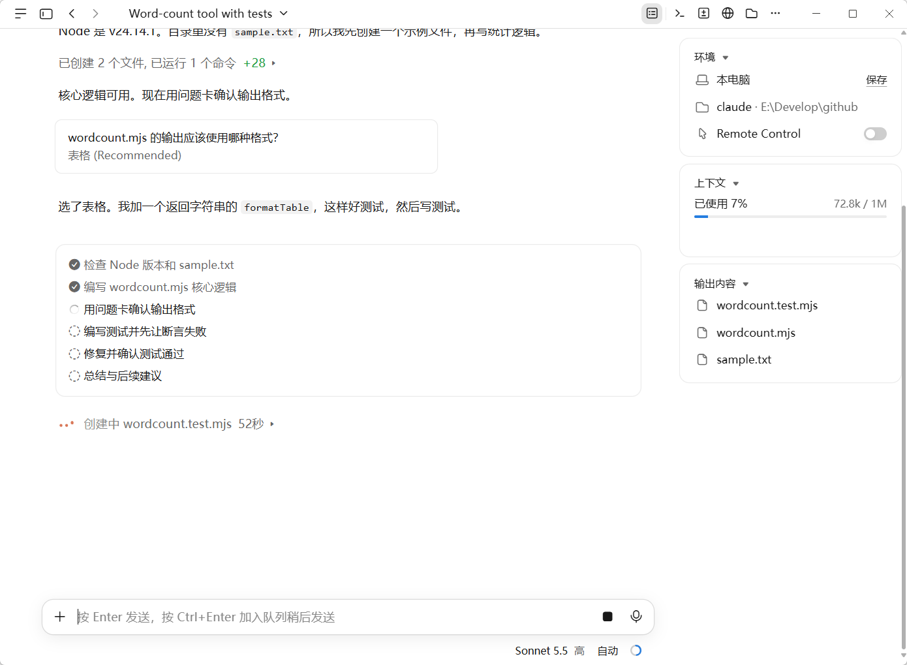
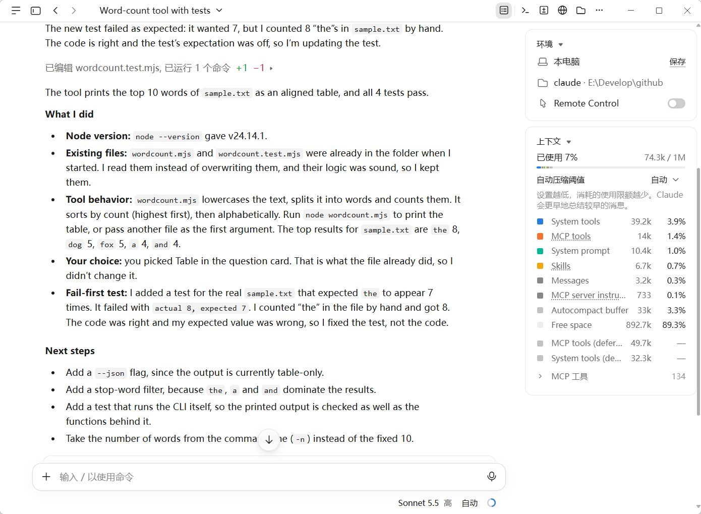
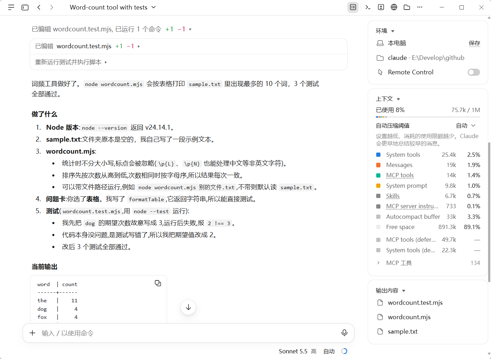
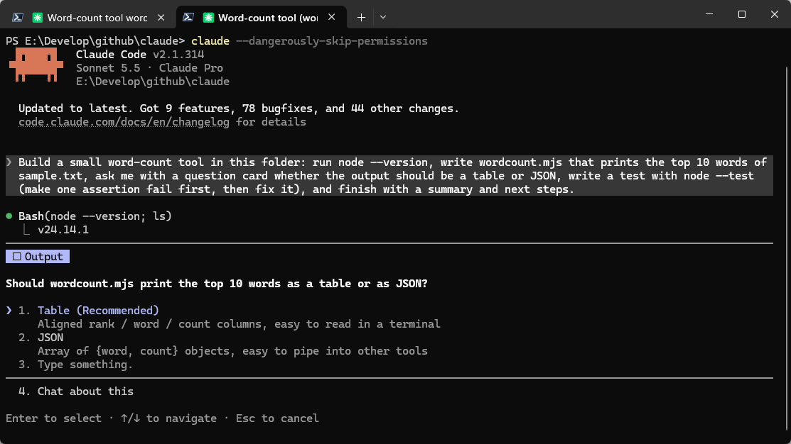
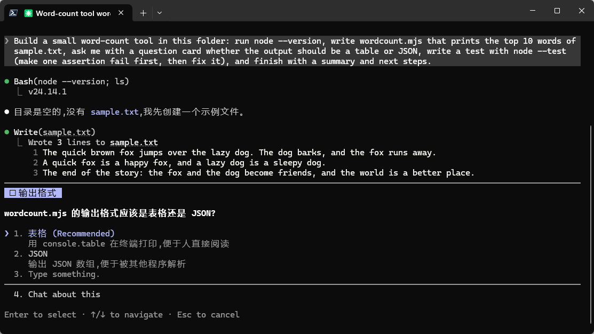
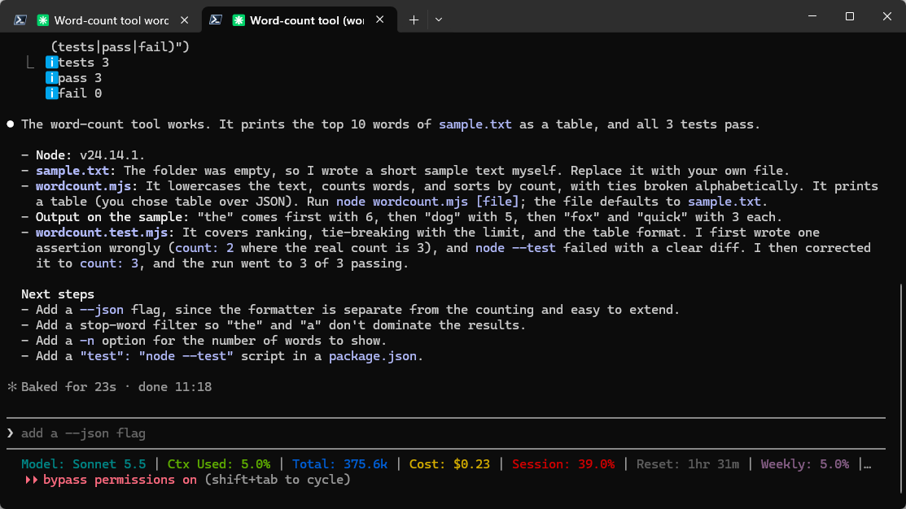
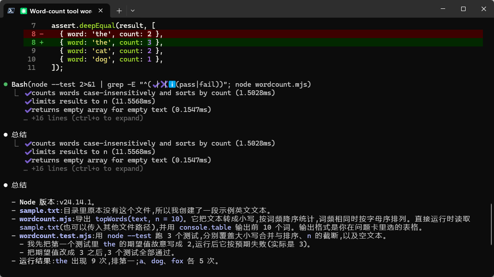

# zh-reply-guard

让 Claude Code 默认用简体中文回复的 Hook。

**默认中文 · 尊重用户语言要求 · 零额外模型调用**

Claude 回复时，Hook 会检查实际输出。发现大段英文时，要求 Claude 改用中文重写；用户明确要求英文或其他语言时放行。判定只用本地的确定性规则，不调用任何模型，不联网，也不需要 API Key。

## 效果对比

同一个英文提示词（没有要求用英文回答），分别在关闭和开启 zh-reply-guard 时运行：

```text
Build a small word-count tool in this folder: run `node --version`, write `wordcount.mjs` that prints the top 10 words of `sample.txt`, ask me with a question card whether the output should be a table or JSON, write a test with `node --test` (make one assertion fail first, then fix it), and finish with a summary and next steps.
```

### Claude 桌面端

#### 问题卡

**无 Hook**：问题、选项和任务列表都是英文。



**有 Hook**：进度说明和问题卡都是中文。



#### 任务列表

**无 Hook**：任务列表、进度说明和正在执行的命令说明都是英文。



**有 Hook**：任务列表、进度说明和命令说明都是中文。



#### 最终总结

**无 Hook**：读完英文的命令输出和测试报错后，总结是英文。



**有 Hook**：总结是中文，代码、命令和文件名保留原文。



### Claude Code CLI

#### 问题卡

**无 Hook**



**有 Hook**



#### 最终总结

**无 Hook**



**有 Hook**



---

## 为什么只写 CLAUDE.md 或设置 language 还不够

在 `CLAUDE.md` 里写"请用中文回复"，或者在 settings 里设置官方的 `"language": "简体中文"`，大多数时候都有效。但下面这些情况，回复经常会切换成英文：

- 连续调用很多次工具的长任务
- 刚读完大段英文的工具输出、报错或文档
- 上下文压缩之后

这些都只是提示，Claude 不一定照做。zh-reply-guard 在提示之外，还会**检查 Claude 实际说了什么**，不合格就让它重写。

## 工作原理

| 事件 | 做什么 |
|---|---|
| `SessionStart` | 没有设置 `language` 时，注入一段中文规则。上下文压缩后会重新注入 |
| `UserPromptSubmit` | 识别用户是否要求了其他语言，例如"用英文回答""翻译成英文""写一个英文 README" |
| `PreToolUse` | 检查问题卡（`AskUserQuestion`）、任务列表（`TodoWrite` 等）和桌面端 wrap_up / update_plan 的文案，英文时在**显示之前**拒绝，让 Claude 用中文重新调用 |
| `Stop` | 检查本轮的最终回复和较长的进度播报，英文时阻断，让 Claude 只把英文段落用中文补写一遍 |

## 安装

需要 Node.js 18 或更高版本（`node --version` 能运行即可）。macOS、Linux、Windows 都支持。

### 方式一：插件（推荐）

不修改你的 `settings.json`，卸载也干净。在终端运行：

```bash
claude plugin marketplace add chrichuang218/claude-zh-reply-guard
```

```bash
claude plugin install zh-reply-guard@zh-reply-guard --scope user
```

也可以在 Claude Code 会话里输入 `/plugin marketplace add chrichuang218/claude-zh-reply-guard`，再用 `/plugin` 安装，作用范围选 User。

装好后**新开一个会话**才会生效。

### 方式二：手动安装

先下载本仓库，然后在仓库目录里运行。

安装到用户目录（所有项目都生效）：

```bash
node scripts/install.mjs
```

只安装到当前项目（在项目根目录运行，会写入 `.claude/settings.json`）：

```bash
node /path/to/zh-reply-guard/scripts/install.mjs --project
```

安装脚本只添加本工具自己的 Hook 条目，其他设置和 Hook 原样保留；修改前会把原文件备份为 `settings.json.bak-zh-reply-guard-<时间>`。如果 `settings.json` 不是有效的 JSON，脚本会停下来，不做任何修改。

### 推荐同时设置官方 language

在 `~/.claude/settings.json` 里加上：

```json
{ "language": "简体中文" }
```

这是官方提供的回复语言设置，属于最基础的预防。设置之后 zh-reply-guard 不再重复注入规则，只负责检查。

## 卸载

插件方式：

```bash
claude plugin uninstall zh-reply-guard
```

手动方式（安装时加了 `--project` 的，卸载时也加上）：

```bash
node scripts/install.mjs --uninstall
```

## 默认规则

被阻断时，Claude 会收到这些要求：

- 面向用户的自然语言默认用简体中文，包括最终回复、进度播报、任务列表、问题卡、总结和按钮文案。
- 工具调用的说明文字（如 Bash、PowerShell 的 description，界面上显示为进度行）也用简体中文。
- 代码、命令、文件路径、API 名称、标识符、日志和提交信息保留原文。
- 只重写英文段落，已经用中文发出的内容不要再发一遍；不要道歉，也不要解释为什么重写。
- 不得为了使用中文而修改代码、工具参数、文件内容、命令或测试结果。

### 例外：什么时候不拦

- **用户要求了其他语言**：例如"用英文回答""以后都用英文""Please answer in English"，以及"翻译成英文""写一个英文 README""写提交信息""生成 PR 描述"。默认只在当前这一轮放行；提问里带"以后""从现在起""from now on"等词时，整个会话都放行，直到用户说"改回中文"。
- **官方 `language` 设成了其他语言**：例如 `"language": "english"`，整个守卫停用。
- **代码块、行内代码、引用块、链接、URL、路径和带提示符的命令行**：这些内容不参与判定，英文报错放进代码块、英文原文用 `>` 引用都不会被拦。
- **日文等其他语言**：本工具只拦英文。

下面这些不算"要求英文"：否定（"不要用英文"）、抱怨（"怎么又用英文了"）、只是提到英文（"这个英文文档讲了什么"），以及粘贴的代码和引用里出现的 English。

## 语言检测怎么判断

1. 先去掉代码块、行内代码、Markdown 链接、URL、邮箱、HTML 标签、引用块、路径和命令行。
2. 在剩下的文字里找"英文句段"：不夹汉字的一段连续英文，至少 6 个普通单词，并且至少包含 2 个 the、is、to、of、and、you 这样的常用虚词。全大写缩写（API）、驼峰词（useState、TypeScript）、带下划线或点的词（foo_bar、node.js）算技术词，不计数。所以中文里夹的技术名词不会被当成英文句子。
3. 统计英文句段的总词数 E 和汉字数 C，算出英文占比 R = E / (E + C / 2)，大约 2 个汉字算 1 个英文词。
4. E 达到阈值并且 R ≥ 0.5 时才判为违规。
5. 工具文案另加一条按字段的规则：任务项、按钮常是 "Run node --version" 这种不带虚词的短句，句段规则抓不到。所以逐个字段看，不含汉字且至少有 2 个普通英文词的算英文字段，含汉字的算中文字段；英文字段至少 2 个、并且比中文字段多时，也判为违规。中文问题配几个英文产品名选项（如 Redis Cluster）不会被拦。

默认阈值：

| 检查对象 | 最少词数 | 说明 |
|---|---|---|
| 最终回复 | 12 | |
| 进度播报（多行） | 12 | |
| 进度播报（单行） | 50 | 一行的工具调用前置说明在界面上显示得很小，拦下来反而会多出一条消息，所以只拦很长的单行 |
| 工具文案 | 8 | 按钮、选项通常很短，同一次调用的文案合并后判定 |

这些默认值用 44 个真实会话、522 轮对话校准过：被拦的回复全部是真正的英文，中文回复的英文占比都在 0.1 以下。

## 可选配置

不配置也能直接用。需要调整时，新建 `~/.claude/zh-reply-guard.json`（用户级）或 `<项目>/.claude/zh-reply-guard.json`（项目级，优先）。完整示例见 [examples/zh-reply-guard.json](examples/zh-reply-guard.json)，只写要改的字段即可：

| 字段 | 默认 | 说明 |
|---|---|---|
| `enabled` | `true` | 总开关 |
| `stopMode` | `"block"` | `block`：用官方阻断协议；`context`：用 `additionalContext` 让 Claude 继续，不显示 Hook 报错（需要较新的 Claude Code） |
| `checkProgress` | `true` | 是否检查进度播报 |
| `checkThinkingUpdates` | `true` | 思考过程以 updates 方式显示时，是否当作进度播报检查 |
| `injectRules` | `true` | 未设置 `language` 时，是否在会话开始时注入规则 |
| `waitSeconds` | `3` | 会话记录还没写入最终回复时最多等待几秒 |
| `maxToolDenies` | `1` | 同一轮里同一个工具最多拒绝几次 |
| `debug` | `false` | 是否写调试日志（环境变量 `ZH_REPLY_GUARD_DEBUG` 优先） |
| `reply` / `progress` / `progressSingleLine` / `tool` | 见上表 | 各组阈值：`minSentenceWords`、`minEnglishWords`、`minEnglishRatio` |
| `tools` | 见示例 | 要检查的工具名，支持正则 |

环境变量（可以写在 settings 的 `env` 字段里）：

- `ZH_REPLY_GUARD=off`：临时关闭全部检查
- `ZH_REPLY_GUARD_DEBUG=1`：开启调试日志

手动安装时的完整 settings 示例见 [examples/settings.json](examples/settings.json)。

## 误判了怎么办

1. **看调试日志**。设置 `ZH_REPLY_GUARD_DEBUG=1` 后，日志写在系统临时目录的 `zh-reply-guard/debug.log` 里。日志只记录事件、判定结果和 E、C、R 这几个数，不记录回复和提问的原文。
2. **用会话记录复查**。会话记录在 `~/.claude/projects/<项目>/<会话 ID>.jsonl`：

   ```bash
   node hooks/zh-reply-guard.mjs --check ~/.claude/projects/<项目>/<会话ID>.jsonl
   ```

   它会列出最后一轮每段文字的判定结果和 E、C、R，不会阻断任何操作。
3. **调整阈值**：在 `zh-reply-guard.json` 里调高 `minEnglishWords` 或 `minEnglishRatio`。
4. **临时关闭**：设置 `ZH_REPLY_GUARD=off`，或在提问里直接说"用英文回答"。

## 能力边界

- **进度播报只能事后补写**。工具调用之间的文字在显示前没有官方事件可以拦截，Stop 时发现英文，只能让 Claude 补一段中文说明。
- **Stop 拦下后，原来的英文仍然看得到**。Claude 会在后面补上中文版本，无法撤回已显示的内容。
- **每轮最多拦一次**。Stop 依靠官方的 `stop_hook_active` 字段，同一工具的拒绝次数也有上限，所以不会无限重试；代价是 Claude 第二次如果还是英文，就会放行。
- **进度播报的检查依赖会话记录（transcript）的格式**，它不是官方公开接口，Claude Code 升级后可能失效；失效时只检查最终回复，不会报错。
- **"要求英文"靠关键词识别**，没有关键词的隐含要求识别不了，这时请用 `ZH_REPLY_GUARD=off` 临时关闭。用英文提问不算要求英文回复。
- **子代理的输出不检查**。子代理的结果交给主 Claude，不直接面向用户。
- **桌面端的 wrap_up / update_plan** 通过 `mcp__.*__wrap_up` 这类正则匹配；CLI 里没有这些工具，匹配不到也没有影响。

## 常见问题

**Hook 没有生效？**
新开一个会话再试，Hook 在会话开始时加载。在会话里输入 `/hooks` 可以看到已加载的 Hook。插件方式还可以用 `claude plugin list` 确认是否已启用。

**提示找不到 node？**
Hook 通过 `node` 命令运行，需要它在 PATH 里。在终端运行 `node --version` 确认。

**PreToolUse 的 matcher 为什么要写成正则？**
matcher 只含字母、数字、`_` 和 `|` 时按精确匹配处理，`wrap_up` 匹配不到真实工具名 `mcp__ccd_turn__wrap_up`。必须写成 `mcp__.*__wrap_up`。

**和其他 Hook 能共存吗？**
可以。Claude Code 会合并各级设置里的 Hook，安装脚本也不会改动其他条目。

**和其他汉化工具能共存吗？**
可以。有些汉化工具会写入 `"language": "Chinese"`，本工具会把它识别为中文，只做检查、不重复注入规则。如果那个工具注入的规则要求"代码注释使用中文"，它和本工具"不改代码"的原则有出入，请按自己的需要取舍。

**会上传我的数据吗？**
不会。只读取 Hook 输入、当前会话本轮的记录和 settings 里的 `language` 字段，全部在本机处理，不联网。会话状态（是否要求了其他语言、本轮拒绝次数）保存在系统临时目录，7 天后自动清理。

## 开发

```bash
node --test
```

## 致谢

设计参考了 [claude-code-japanese-guard](https://github.com/minorun365/claude-code-japanese-guard)（Apache-2.0），包括同时用 `last_assistant_message` 和会话记录判定、一行前置说明不拦、桌面端 wrap_up 的匹配写法、只要求重写英文段落的反馈方式，以及 `--check` 命令。本项目用 Node.js 重新实现，没有复制它的代码。

## 许可

[MIT](LICENSE)
